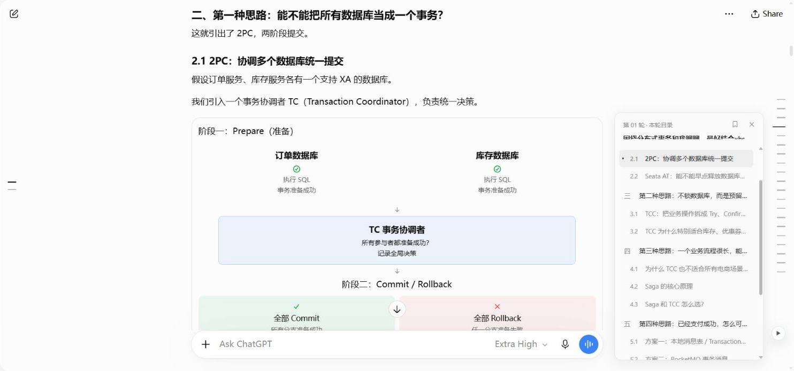
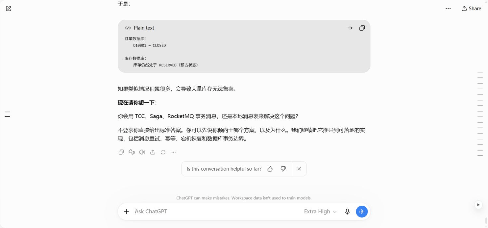

# Threadmark · ChatGPT 对话目录

长对话里，快速回到某一轮提问，再定位到回答中的 `1.1`、`1.2`、`2.1`。

Threadmark 是一个无需编译的 Chrome / Edge Manifest V3 扩展：**左侧定位对话轮次，右侧展开当前轮次的小节目录**。使用原生 JavaScript，不需要 API Key。






> 演示来自 chatgpt.com 的真实历史会话，使用 0.3.1 扩展。左侧账号栏已裁去。

## 安装

1. 在仓库右上方点击 **Code → Download ZIP**，解压到一个固定文件夹；也可以下载 [Releases](https://github.com/maomaozhe/threadmark-chatgpt-outline/releases) 中的安装包。
2. Chrome 地址栏打开 `chrome://extensions`；Edge 打开 `edge://extensions`。
3. 开启「开发者模式」，点击「加载已解压的扩展程序」。
4. 选择包含 **manifest.json** 的文件夹。不要选择 ZIP 文件或它的上层文件夹。
5. 刷新已经打开的 ChatGPT 网页。正文左侧显示轮次短线，右侧显示当前回答的小节短线。

不需要运行 npm 或安装开发依赖。当前采用开发者模式安装，尚未上架扩展商店。[Chrome 官方加载说明](https://developer.chrome.com/docs/extensions/get-started/tutorial/hello-world#load-unpacked)

更新时，用新文件覆盖原安装目录，在扩展管理页点击「重新加载」，然后刷新 ChatGPT 网页。

## 使用

| 位置 | 操作 | 效果 |
| --- | --- | --- |
| 左侧短线 | 悬停或键盘聚焦 | 预览该轮提问和回答开头 |
| 左侧短线 | 点击 | 定位到该轮提问，右侧切换为该轮目录 |
| 左侧卡片 | 搜索关键词、输入轮次 | 快速查找问题或小节；可输入 `3`、`第3轮` |
| 右侧短线 | 悬停或键盘聚焦 | 展开当前轮次的小节目录 |
| 右侧目录 / 短线 | 点击小节 | 跳转到正文标题并短暂高亮 |
| 右侧书签图标 | 固定 | 目录保持展开，随当前阅读轮次更新；宽屏正文预留空间 |
| 右侧关闭按钮 | 收起 | 保留短线，继续阅读正文 |

- 两侧独立操作。仅预览左侧其他轮次时，右侧仍显示当前阅读轮次。
- 未悬停时两侧短线统一为 16px；当前项仅用颜色标记。悬停或键盘聚焦时展开详情，移开后自动收起；仅手动点击书签才固定。
- 滚动正文时，轮次和当前小节标记自动同步。
- 新提问、逐字生成、重新生成回答以及切换会话时自动更新。
- 配色通过 `prefers-color-scheme` 跟随**操作系统**，无需单独设置。若 ChatGPT 自身被手动固定为另一种主题，两者颜色可能不同。
- 可用 Tab 聚焦按钮、Enter 跳转；焦点位于卡片中时按 Escape 收起。`Alt + Shift + O` 或工具栏图标切换左侧卡片。
- 窄屏点击跳转后自动收起卡片；右侧目录过长时可独立滚动。

## 标题识别

支持 Markdown H1–H6，以及独立段落 / 列表中的编号标题：

```markdown
## 1. 整体思路
### 1.1 背景
### 1.2 实现
#### 1.2.1 关键细节
## 2. 验证
### 2.1 测试方法
```

也支持 `一、背景` 等中文编号。代码块、表格、引用、隐藏分支和说话人标签会被过滤。没有标题或编号的普通长段落不会被猜测为目录。

## 试用演示

双击打开 [preview/index.html](preview/index.html)，即可在本地使用完整交互，无需登录或联网。演示页与扩展使用同一套源代码；页尾按钮可模拟新一轮对话和流式补充小节。

## 隐私与权限

- 仅在 `chatgpt.com` 和旧域名 `chat.openai.com` 运行。
- 只申请 `storage` 权限，保存左右卡片的两个布尔偏好。
- 在当前网页内读取已加载的消息 DOM，目录保留在内存中；不保存聊天正文。
- 扩展代码不发送网络请求，不调用模型，没有统计、远程脚本或后台服务器。
- 不读取账户凭据、Cookie 或 ChatGPT 私有接口。[Content scripts 工作机制](https://developer.chrome.com/docs/extensions/develop/concepts/content-scripts)

## 兼容与边界

- 已有 Chrome 真实历史会话验证记录，详情见 [TESTING.md](TESTING.md)。Edge 的 MV3 安装方式适用，尚未单独完成安装实测。
- 只索引**当前网页已经加载**的消息。超长会话请先向上滚动加载历史；轮次从当前已加载的第一条提问开始，不能保证虚拟化会话的绝对轮次。
- 重新生成回答 / 切换分支时，只索引当前显示的分支。
- ChatGPT 页面结构可能变化，适配器集中在 `src/core.js`。遇到目录缺失，可在左侧目录中点击重新扫描；仍失败时请提交不含私密聊天内容的复现步骤。
- Threadmark 是独立开源项目，与 OpenAI 没有隶属关系。

## 开发

Node.js 18+；开发检查使用 jsdom，安装扩展无需依赖。

```sh
npm ci
npm test
```

37 项回归检查覆盖消息适配、层级、跳转、搜索、流式更新、会话切换、两侧目录同步、固定与键盘焦点。

打包需要 Python 3.9+：

```sh
npm run package
```

安装包生成到 `dist/Threadmark-0.3.1.zip`，仅包含显式列出的扩展与说明文件，不包含 Git 元数据或开发依赖。

```text
manifest.json          域名范围、权限与加载顺序
background.js          工具栏按钮与快捷键
src/core.js            消息适配、轮次归组、标题识别
src/panel.js           左侧轮次与搜索卡片
src/styles.js          左侧样式
src/section-panel.js   右侧当前轮次目录
src/content.js         自动更新、定位、阅读位置与偏好
preview/               使用同一源码的模拟对话
docs/                  演示截图与动图
tests/                 自动化回归检查
scripts/package.py     ZIP 安装包生成
```

[MIT License](LICENSE)
